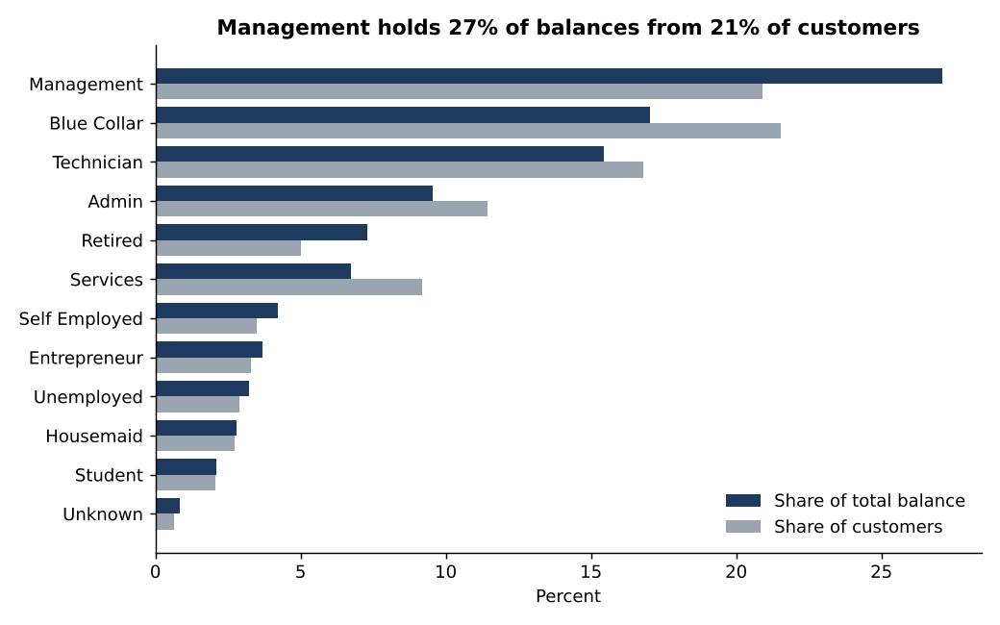
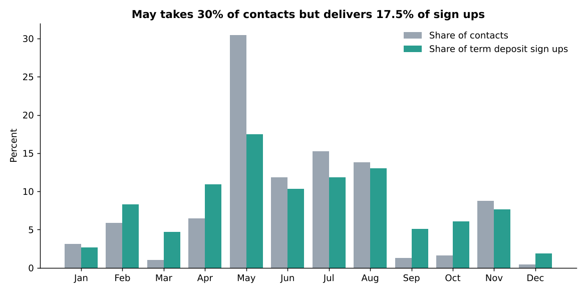
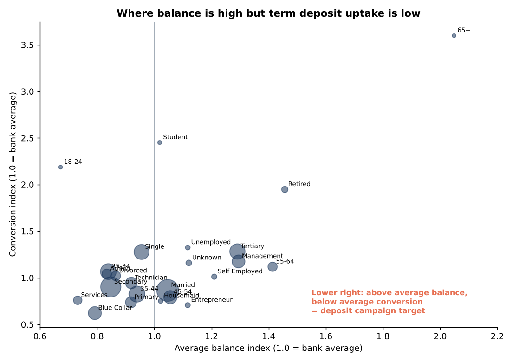

# Bank Customer & Deposit Analytics

An analysis of customer segments, deposit balances, and telemarketing performance using data from a Portuguese retail bank. The project uses MySQL, Excel, Python, and Power BI to explore customer behaviour, identify business opportunities, and translate findings into actionable recommendations.

## Project Overview

Retail banks need to understand how customer characteristics relate to deposit balances, product adoption, and campaign performance. This project explores these areas using a dataset of 45,211 bank customers.

The analysis focuses on three questions:

- Which customer segments account for the largest share of deposit balances?
- How do customer characteristics and existing banking products relate to term deposit subscriptions?
- What patterns can be found in campaign timing, contact channels, and customer responses?

The goal is to go beyond descriptive statistics and identify patterns that could inform customer targeting and marketing decisions.

## Dataset & Scope

The analysis uses the Bank Marketing dataset from a Portuguese bank, containing 45,211 customer records.

The dataset includes customer demographics, occupation, account balance, existing loan information, contact history, campaign details, and the outcome of a term deposit marketing campaign.

It does not contain branch-level information, transaction histories, customer income, or yearly account records. As a result, the project focuses on the variables available rather than attempting to measure metrics that the dataset cannot support.

| Original business question | Analysis used in this project |
|---|---|
| Branch performance | Contact channel, campaign month, and contact intensity |
| Customer income segments | Occupation and account balance bands |
| Active vs. inactive customers | Balance and existing product ownership as proxy indicators |
| Savings, current accounts, fixed deposits, and card adoption | Housing loans, personal loans, and term deposits |
| Deposit performance | Average yearly account balance (EUR) |

For the proxy measures, 16.1% of customers have zero or negative balances, while 31.1% hold neither a housing nor a personal loan. These figures should not be interpreted as actual inactive-account rates.

Further details on the dataset's limitations and metric definitions are available in [`docs/limitations.md`](docs/limitations.md).

## Key Findings

The analysis revealed several patterns in customer balances, product adoption, and campaign performance.

### 1. Deposit concentration

The top 10% of customers account for 56% of all positive account balances. This indicates that deposits are concentrated among a relatively small group of customers.



### 2. Differences across occupations

Management customers account for 27% of total balances while representing 21% of the customer base. Blue-collar customers account for 17% of balances and 21.5% of customers.

The difference is also visible in campaign performance: the blue-collar segment has a 7.3% term deposit subscription rate, compared with the overall bank rate of 11.7%.

### 3. Potential customer segments for targeting

Entrepreneurs and customers aged 45–54 have above-average account balances but below-average term deposit uptake.

This combination makes them potential segments for targeted term deposit campaigns. They already hold relatively higher balances, but their subscription rates suggest room for improvement.

### 4. Contact channel performance

A substantial share of campaign contacts (28.8%) has no recorded contact channel. This group has a conversion rate of 4.1%, compared with 14.9% for cellular contacts.

The difference suggests that contact channel is an important factor to consider when evaluating campaign performance.

### 5. Campaign timing

May accounts for 30.4% of all contacts but only 17.5% of term deposit subscriptions.



The gap between contact volume and subscriptions suggests that higher outreach volume does not necessarily translate into better campaign outcomes.

### 6. Previous campaign acceptance

Customers who accepted a previous offer have a 64.7% acceptance rate in the current campaign.

Previous campaign outcomes therefore provide a useful signal for identifying customers who may be more receptive to future offers.



The full analysis, supporting tables, and seven business recommendations are available in [`docs/findings_and_recommendations.md`](docs/findings_and_recommendations.md).

## Repository Structure

| Directory | Contents |
|---|---|
| `data/raw/` | Original `bank-full.csv` dataset |
| `data/processed/` | Cleaned dataset, Power BI dimension tables, validation reports, SQL results, statistical tests, and segment summaries |
| `sql/` | MySQL data loading, data model creation, business queries, window functions, and data quality checks |
| `python/` | Data cleaning, SQL reconciliation, statistical analysis, chart generation, and Excel workbook creation |
| `excel/` | `Bank_Customer_Analytics.xlsx` with formulas and validation checks |
| `powerbi/` | DAX measures, dashboard theme, and four-page dashboard build guide |
| `docs/` | Findings and recommendations, data limitations, data dictionary, and CV bullet points |
| `images/` | Charts included in the project documentation |

## Reproducing the Analysis

The project can be reproduced using Python without setting up a database. SQL queries are executed through SQLite and their results are reconciled against independent pandas calculations.

### Python workflow

Install the required packages:

```bash
pip install -r requirements.txt
```

Run the scripts in the following order:

```bash
python python/01_clean_validate_export.py

python python/02_run_sql_and_reconcile.py

python python/03_stats_and_charts.py

python python/04_build_excel.py
```

The final script generates the Excel workbook. Open it in Excel to calculate the formulas.

### MySQL workflow

For the MySQL implementation, execute the SQL scripts in the order indicated by their numbering, from data loading through data quality checks, using MySQL 8.

## Technical Approach & Validation

Several checks were used to ensure that the analysis was consistent across the different tools.

- **Data quality:** 17 checks covering missing values, duplicate records, valid ranges, code consistency, unknown values, and outliers.
- **SQL analysis:** CTEs, range joins, NTILE, RANK, LAG, running totals, and a portable median calculation.
- **Cross-validation:** 59 SQL output values were compared against independent pandas calculations. All 59 matched.
- **Excel validation:** The workbook contains 362,293 formulas with zero formula errors. Its Validation sheet matches Python results across nine checks.
- **Statistical analysis:** Two-proportion z-tests and Wilson confidence intervals were used to examine key conversion differences. Bootstrap confidence intervals were also calculated for average account balances by occupation.

## Tools & Technologies

| Tool | Application |
|---|---|
| MySQL 8 | Data querying, segmentation, and aggregation |
| Python | Data cleaning, statistical analysis, and visualization |
| Pandas & NumPy | Data manipulation and calculations |
| SciPy | Statistical testing |
| Matplotlib | Data visualization |
| Excel | Workbook generation, formulas, and validation |

## Data Source

Moro, S., Cortez, P., & Rita, P. (2014). *A data-driven approach to predict the success of bank telemarketing*. Decision Support Systems.

Dataset: [UCI Machine Learning Repository – Bank Marketing](https://archive.ics.uci.edu/dataset/222/bank+marketing)
